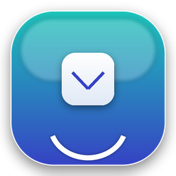
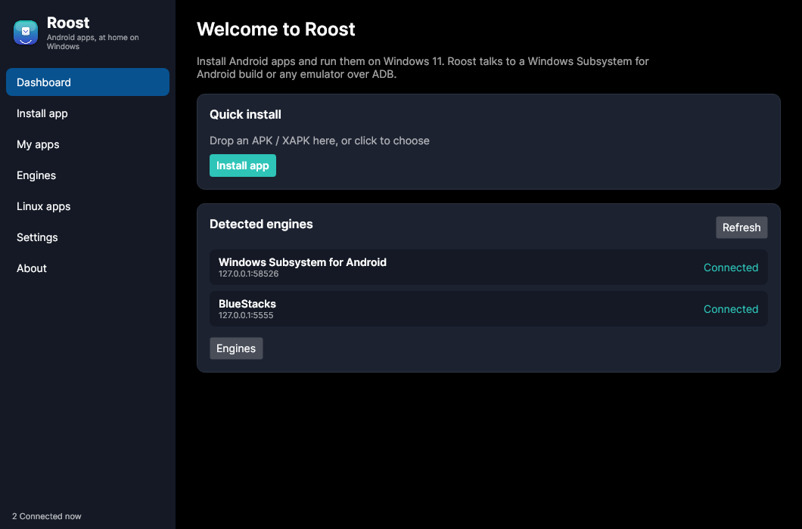
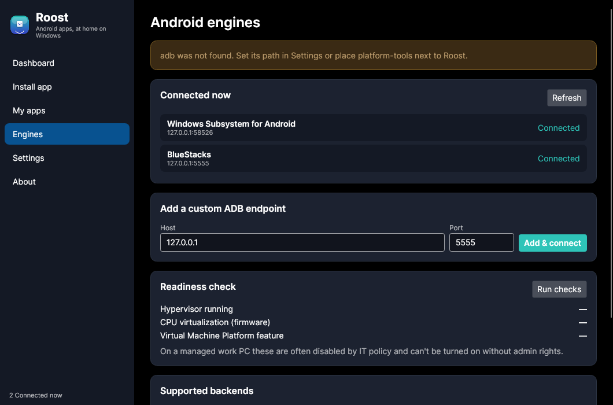
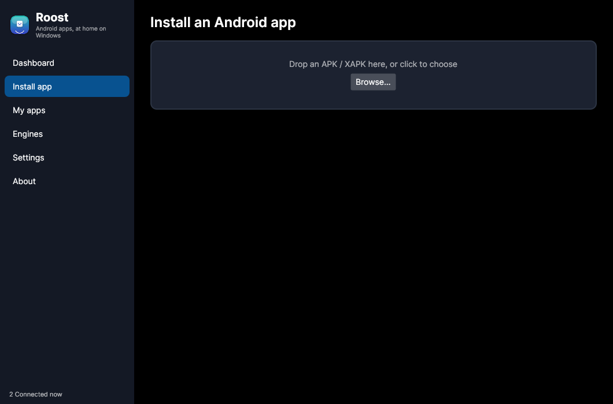
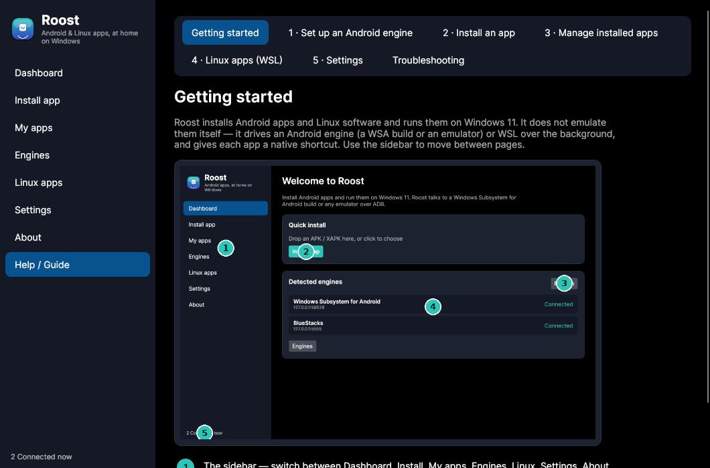

<p align="center">
  
</p>

<h1 align="center">Roost</h1>

<p align="center">
  <b>התקנה והרצה של אפליקציות אנדרואיד ותוכנות Linux על Windows 11 — עם קיצור דרך מקורי לכל אפליקציה.</b><br>
  <b>Install and run Android apps and Linux software on Windows 11 — with a native shortcut for every app.</b>
</p>

<p align="center">
  
  
  
  
</p>

<p align="center">
  
</p>

---

## עברית

### מה זה Roost
Roost מתקין אפליקציות אנדרואיד ומריץ אותן ב-Windows 11. הוא **לא מריץ אנדרואיד בעצמו** — הוא מתזמר מנוע אנדרואיד קיים דרך **ADB**: או גרסת **WSA** קהילתית (האפליקציות מרגישות מקוריות), או כל **אמולטור** (BlueStacks, LDPlayer, MuMu, Nox). לכל אפליקציה שמתקינים נוצר **קיצור דרך בתפריט התחל** עם האייקון שלה, שמפעיל אותה ישירות.

> **חשוב לדעת לפני שמתחילים**
> - צריך **מנוע אנדרואיד** + **וירטואליזציה חומרתית**. Roost מתזמר אותם, הוא לא מחליף אותם. צריכת הזיכרון המינימלית נקבעת ע"י המנוע (‎~1.5–2GB‎), לא ע"י Roost (שהוא קל).
> - מיקרוסופט **הפסיקה את WSA הרשמי** ב-5.3.2025, ולכן המסלול ה"מקורי" מסתמך על גרסת WSA קהילתית. אמולטורים הם חלופה זמינה ויציבה.
> - במחשב **עבודה מנוהל** ייתכן שה-IT חוסם וירטואליזציה / Hyper-V / Developer Mode — ואז לא ניתן להתקין מנוע כלל. עובד מצוין במחשב אישי.

### שימוש
1. **מנועים** → לחץ "הורד adb אוטומטית" (אם אין adb), ואז "רענון" כדי לזהות מנועים מחוברים. אפשר גם להוסיף כתובת ADB ידנית, ולהריץ "בדיקת מוכנות".
2. **התקנת אפליקציה** → גרור קובץ ‎`.apk` / `.xapk` / `.apks` / `.apkm`‎, בחר מנוע יעד, ולחץ "התקן". סמן "צור קיצור דרך" כדי לקבל אייקון בתפריט התחל.
3. **האפליקציות שלי** → הפעלה / הסרה / יצירת קיצור דרך לכל אפליקציה.

### יכולות
- זיהוי אוטומטי של WSA ואמולטורים נפוצים, והוספת כתובת ADB מותאמת.
- התקנת APK וחבילות מפוצלות (XAPK/APKS) כולל הענקת הרשאות.
- קריאת שם/גרסה/אייקון/הרשאות (דרך aapt2, רשות).
- קיצורי דרך מקוריים בתפריט התחל / שולחן עבודה, עם האייקון של האפליקציה.
- ערכת נושא בהירה/כהה, **עברית ואנגלית** (כולל RTL מלא).
- קל: ה-exe עצמו צורך מעט, עם אפשרות "השהיית מנוע במנוחה" לחיסכון בזיכרון.

---

## English

### What Roost is
Roost installs Android apps and runs them on Windows 11. It **does not run Android itself** — it orchestrates an existing Android engine over **ADB**: either a community **WSA** build (apps feel native) or any **emulator** (BlueStacks, LDPlayer, MuMu, Nox). Each installed app gets a **Start-Menu shortcut** with its own icon that launches it directly.

> **Read this first**
> - You need an **Android engine** + **hardware virtualization**. Roost orchestrates them; it doesn't replace them. The minimum RAM floor is set by the engine (~1.5–2 GB), not by Roost (which stays light).
> - Microsoft **discontinued the official WSA** on 2025-03-05, so the "native" path relies on a community WSA build. Emulators are an available, maintained alternative.
> - On a **managed work PC**, IT may block virtualization / Hyper-V / Developer Mode, so no engine can be installed. It works great on a personal PC.

### Usage
1. **Engines** → click *Download adb automatically* (if adb is missing), then *Refresh* to detect connected engines. You can also add an ADB `host:port` manually and run the *Readiness check*.
2. **Install app** → drop an `.apk` / `.xapk` / `.apks` / `.apkm`, pick a target engine, and click *Install*. Tick *Create a shortcut* for a Start-Menu icon.
3. **My apps** → launch / uninstall / create a shortcut for any installed app.

<p align="center">
  
  
</p>

### How it works
A tool can't run Android apps by itself — it talks to an engine. Roost connects to the engine's ADB endpoint (WSA on `127.0.0.1:58526`, emulators on their own ports), runs `adb install` / `install-multiple`, and writes a native `.lnk` that re-launches each app through Roost (`--launch`), so it behaves like a normal Windows program.

### Linux apps (WSL)
The **Linux apps** page runs Linux GUI software on Windows 11 through **WSL 2 + WSLg** (real, first-class on Windows 11 — not a hack). Roost detects your distributions, installs packages with `apt`, lists the installed GUI apps from their `.desktop` entries, and launches them or pins a native Start-Menu shortcut. WSL 2 needs the Virtual Machine Platform feature (`wsl --install`).

### Built-in guide
Roost ships a full **Help / Guide** page (English + Hebrew) with annotated screenshots and numbered, step-by-step instructions for every page — open it from the sidebar.

<p align="center"></p>

### Why no iOS / macOS yet
iOS and macOS apps need Apple's own OS (Darwin/XNU) and frameworks, normally on Apple hardware. There is no working, general way to run them natively on Windows, so Roost does **not** pretend to — that support is on the roadmap only if a viable runtime path is validated, and will meet the same quality bar as Android.

### Install

**Direct download (portable, no .NET needed, just run it):**
[`downloads/Roost-v1.2.1-portable.exe`](https://github.com/bennymat93/Roost/raw/main/downloads/Roost-v1.2.1-portable.exe)

Or, once a [release](../../releases/latest) is published, from there:
- **`Roost-Setup.exe`** — installer (per-user, no admin).
- **`Roost.exe`** — portable, self-contained (no .NET needed).
- **`Roost-framework-dependent.zip`** — small build; needs the [.NET 8 Desktop Runtime](https://dotnet.microsoft.com/download/dotnet/8.0).

> Not code-signed, so SmartScreen may warn on first run: *More info → Run anyway*.

---

## Build from source
Requires the **.NET 8 SDK** (works on Windows or Linux):
```bash
pwsh ./build.ps1                      # self-contained single exe -> dist/Roost.exe
pwsh ./build.ps1 -FrameworkDependent  # small build -> dist-fd/
```
The icon is generated by `scripts/make_icons.py` (Python + Pillow). The installer is `installer/Roost.iss` (Inno Setup). CI (`.github/workflows/release.yml`) builds all three artifacts and the installer on tag `v*`.

## Project layout
```
src/Roost/            Avalonia app (MVVM)
  Models/             data types
  Services/           ADB, engine detection, APK inspector, shortcuts, settings, i18n
  ViewModels/         one per page
  Views/              Avalonia XAML
  Assets/             generated icon
tools/Shot/           headless screenshot harness (dev/QA only)
installer/Roost.iss   Inno Setup installer
scripts/              icon generator
```

## License
MIT — see [LICENSE](LICENSE). "Android" is a trademark of Google LLC; Roost is not affiliated with Google and bundles no Google binaries.
